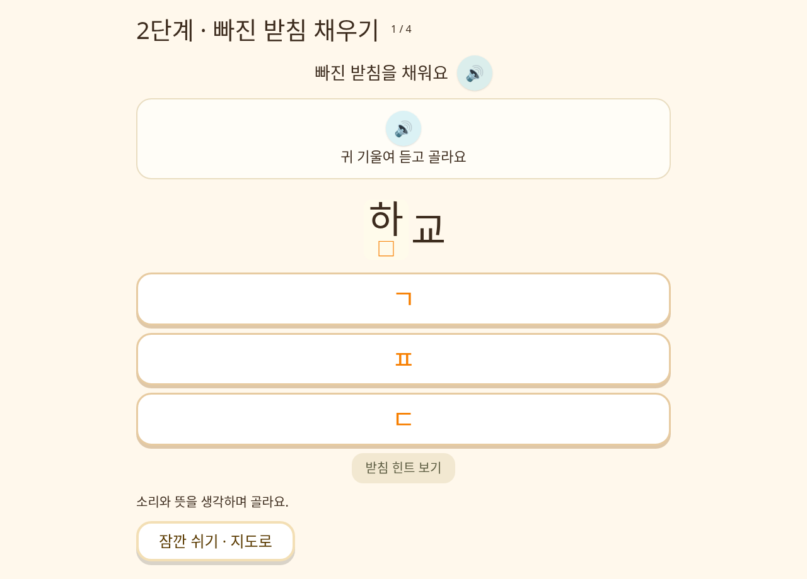
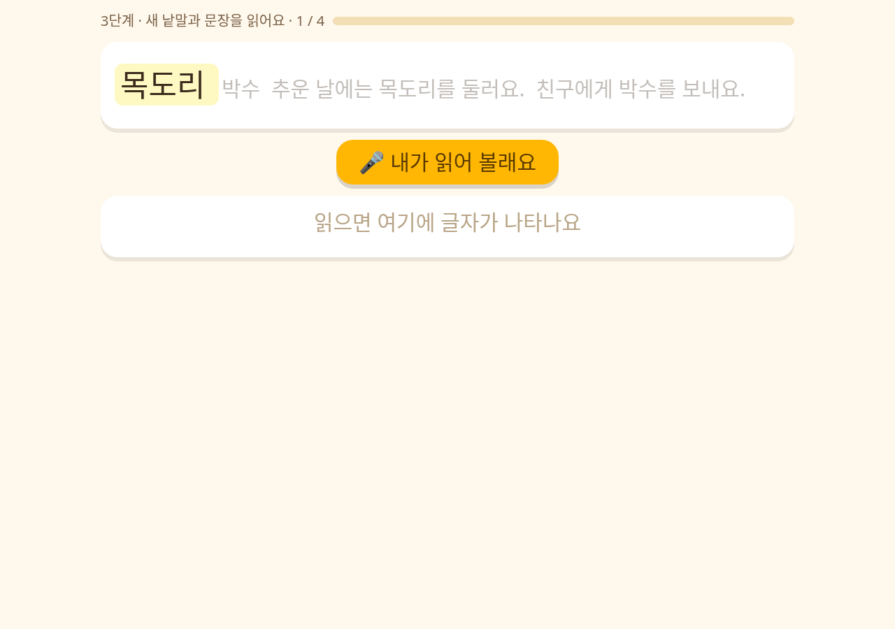
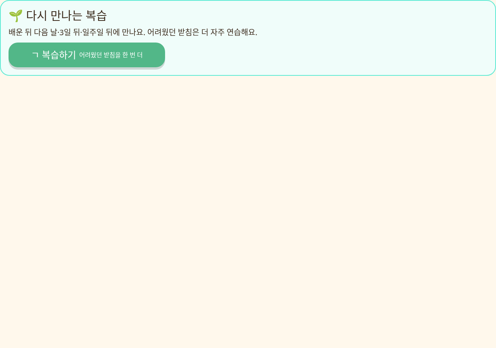
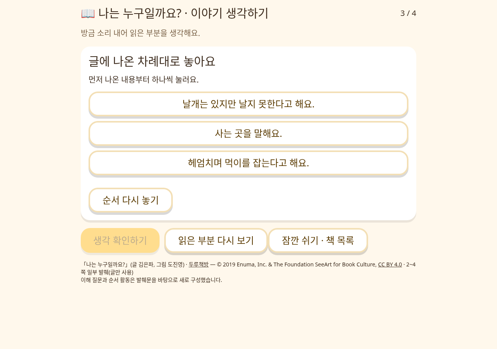
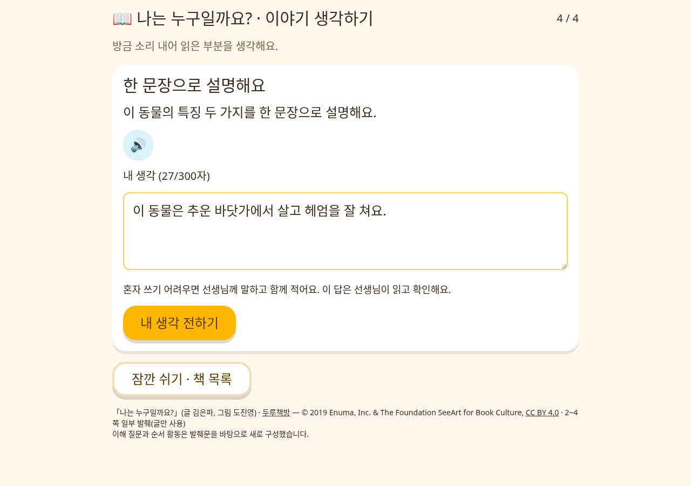

# 깊이 익히기와 날짜별 복습

학생 화면은 `/`, 교사 화면은 `/teacher`입니다.

## 학생이 확인하는 순서

1. 사이트를 새로고침하고 학급 코드와 번호로 입장합니다.
2. 받침 단원에서 **듣고 고르기 → 빠진 받침 채우기 → 새 낱말·문장 소리 내어 읽기**를 진행합니다. 이미 낱말·문장을 마친 단원은 새 활동부터 이어집니다.
3. 지도 위 **다시 만나는 복습**에서 오늘 복습과 다음 날짜를 확인합니다.
4. **읽기 테스트 → 책 읽기 → 소리 내어 읽기 → 이야기 생각하기**로 들어갑니다. 이미 읽기를 통과한 책은 ③ 버튼으로 생각하기를 바로 열 수 있습니다.
5. 네 단원의 새 읽기까지 마치면 중간 평가를 풉니다. 새 평가는 단원당 듣기·받침 채우기·문장 문항 하나씩, 총 **12문항**입니다.

## 추가된 학습량

- 받침 15단원: 각 단원에 받침 채우기 4문항, 새 낱말 2개와 새 문장 2개 읽기.
- 전이 어휘 60개와 문장 60개: 기존 듣기 문제와 다른 낱말·표현을 별도 구성했습니다. 일부는 이후 복습에서 만납니다.
- 복습: 듣기 2문항, 받침 채우기 2문항, 바뀐 낱말·문장 읽기 2개씩.
- 두루책방 17권: 책마다 내용 이해 2문항, 순서 활동 1개, 한 문장 설명 1개. 질문은 앱에서 실제로 발췌해 읽은 범위에 근거합니다. 설명글은 사건 순서 대신 소개된 내용의 순서를 확인합니다.

읽기 이해의 선택 문항과 자유 서술을 구분합니다. 한 문장 설명은 자동 정답 처리하지 않고 교사 상세 화면에 원문으로 보여 줍니다. 글쓰기가 어려운 학생은 교사와 함께 입력할 수 있습니다.

## 화면 예시

실제 학생 정보 없이 검사용 화면으로 촬영했습니다. 아래 그림을 누르면 크게 볼 수 있습니다.

### 빠진 받침 채우기



### 새로운 낱말·문장 읽기



### 다시 만나는 복습



### 이야기 순서와 한 문장 설명





## 복습 날짜와 기록

- 한국 날짜를 기준으로 배운 다음 날, 3일 뒤, 7일 뒤 확인합니다. 예: 10월 1일 학습 → 2일·4일·8일 복습.
- 첫 시도에서 틀렸거나 힌트·교사 도움을 받으면 다음 날 보충 복습합니다. 성공하면 다음 간격으로 넘어갑니다.
- 늦게 접속했을 때 여러 회차가 같은 날 연속으로 열리지 않습니다. 다음 회차는 최소 다음 날입니다.
- 중간 평가에서 어려웠던 단원은 복습 예정일을 앞당깁니다. 마지막 복습까지 끝낸 단원도 평가에서 어려움이 나타나면 다시 엽니다.
- 배포 전에 마친 단원도 이후 첫 접속을 기준으로 복습 일정을 만듭니다. 이전 진도·별·직업 도구는 보존합니다.
- 중간 평가의 **잠깐 쉬기**는 풀이를 기억하고 지도로 돌아갑니다. 다시 열면 이어집니다.
- 풀이 중 답과 한 문장 초안은 학생별·활동별로 기기에 저장합니다. **결과 저장하기**를 누르면 기기에 먼저 보관하고 바로 다음 화면으로 이동합니다. 서버 전송은 자동으로 진행하며 연결이 끊기면 같은 학생으로 접속했을 때 다시 전송합니다. 이야기의 **내 생각 전하기**도 바로 책 목록으로 이동합니다. 읽기 도중에는 이미 넘어간 문장까지 이어 읽습니다.
- 학습 기록 조회가 실패해도 다시 불러오기 화면으로 막지 않습니다. 기기의 풀이·이전 정보를 사용하며, 둘 다 없으면 해당 추가 활동을 건너뛰고 다음 화면으로 이동합니다. 이를 학습 완료 기록으로 저장하지는 않습니다.
- 원래 읽기 규칙처럼 세 번 읽어도 통과하지 못하면 교사 확인을 기다립니다. 마이크 기능은 해당 기기와 브라우저의 음성 인식을 사용합니다.

교사 화면의 **학급 → 학생 상세 → 깊이 익히기·복습·이야기 이해**에서 복습 날짜, 스스로 해결한 수, 도움·재시도 수, 학생의 한 문장을 확인합니다.

## 구현과 검증

`supabase/deeper_learning.sql`은 기존 `checkpoint_missions.sql` 뒤에 적용합니다. `learning_sessions`, `learning_schedule`에 RLS를 적용하고 저장·일정 계산은 권한을 검증하는 RPC에서 처리합니다. 학생은 자기 기록만, 교사는 자기 학급 기록만 조회합니다. 기록 초기화는 복습·이해 활동과 기기 세대를 함께 처리하며, 별·직업만 초기화하면 학습 기록은 유지됩니다.

기존 4문항 평가와 지급 이력은 보존됩니다. 새로 시작하는 평가부터 12문항으로 구성합니다. 초기화 없이 이미 완료한 평가를 새 평가로 덮어쓰거나 도구를 다시 지급하지 않습니다.

검증 명령:

```sh
npm run build
npm run check
npm run test:missions
npm run test:learning
# npm run dev -- --host 127.0.0.1 실행 후
npm run test:missions:browser
npm run test:learning:browser
```

브라우저 검사는 실제 컴포넌트를 실행하되 API와 음성 인식을 모의 처리하므로 운영 학생 데이터를 생성하거나 바꾸지 않습니다. 데이터 검사는 실제 마이그레이션을 PGlite PostgreSQL에 적용해 날짜 간격, 중복 제출, 권한 격리, 초기화, 기존 평가 보존을 확인합니다.
