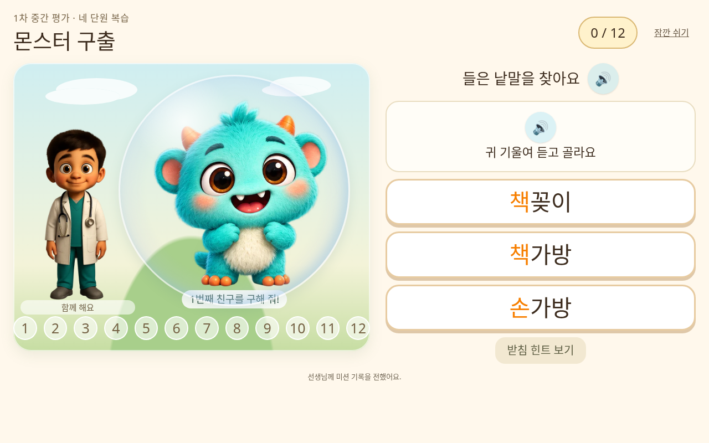
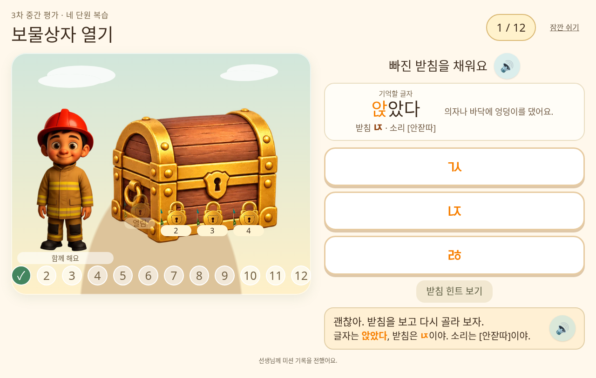
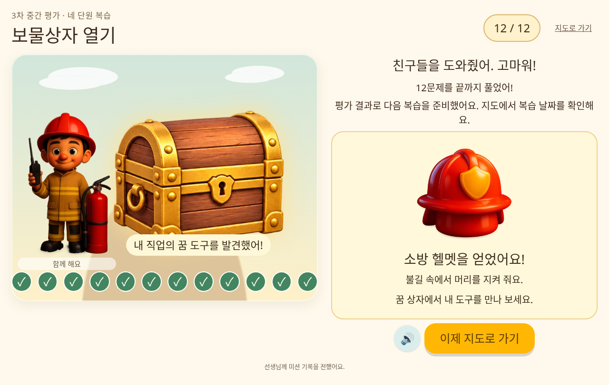
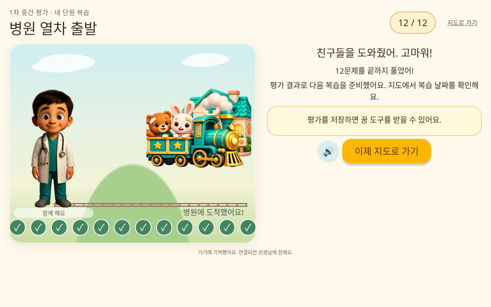

# 네 단원마다 중간 평가 미션

학생은 QR과 일반 주소 모두 매번 **학급 코드 → 학생 번호**를 입력해 입장합니다. 새로고침하거나 브라우저가 이전 페이지를 복원할 때도 코드 입력부터 시작합니다.

심화 학습과 복습이 추가되었습니다. [새 학습 흐름과 화면 보기](deeper-learning.md)

## 학생 입장과 문제 보기

교사 대시보드의 QR은 `/join`으로 연결됩니다. 기기에 이전 학생이 저장돼 있어도 **빈 학급 코드 입력 화면**부터 시작합니다. 교사가 알려 준 여섯 자리 코드를 누르고 **입장하기 → 내 번호** 순서로 입장합니다. 예전 `?c=학급코드` QR도 코드를 자동 입력하거나 이전 학생으로 들어가지 않습니다.

홑받침 문제의 오답은 `src/data/listeningChoices.ts`의 실제 낱말을 사용합니다. 예를 들어 **운동장 / 운동화 / 농구장**, **약속 / 약국 / 박수**를 비교합니다. 받침을 바꿔 만든 가짜 낱말은 제시하지 않습니다. 기존 교육과정의 문항 ID·낱말 순서·발음은 유지합니다.

## 평가 시점과 진행

미션은 네 단원의 **낱말·문장과 새 낱말 읽기를 모두 마친 후** 열립니다. 낱말 학습 직후에는 곧바로 문장 학습으로 이어집니다.

| 평가 | 학습 범위 | 열리는 시점 |
| --- | --- | --- |
| 1차 | 1-1 ~ 1-4 | 4번째 단원 완료 |
| 2차 | 1-5 ~ 1-8 | 8번째 단원 완료 |
| 3차 | 2-1 ~ 2-4 | 12번째 단원 완료 |

각 평가에서는 네 단원에서 듣기·받침 채우기·문장 문제를 하나씩, 총 12문제를 풉니다. 단원 완료 화면의 **중간 평가 미션** 또는 지도 아래 평가 버튼으로 들어갑니다. 남은 2-5 ~ 2-7은 다음 네 단원 묶음을 채우지 않으므로 별도 평가가 생기지 않습니다.

평가 범위 안의 최근 기록에서 반복 오류를 우선하며, 충분한 낱말·문장 수행 차이가 있으면 병원 열차를 제안합니다. 그 밖에는 공통 복습입니다. 음성 인식 기록은 추천 판단에 넣지 않습니다. 처음부터 정답 글자를 보여 주지 않으며, 오답 또는 힌트 후 글자·받침·발음을 확인합니다. 겹받침에는 뜻 단서도 제공합니다.

첫 시도 정오, 힌트, 재도전, 최종 해결과 세 번 오답 후 설명을 보고 진행한 결과를 따로 기록합니다. 평가 결과는 기존 정답률·성장 그래프에 합산하지 않고 별도 기록으로 보여 줍니다. 완료한 평가를 다시 열면 완료와 보상 화면을 보여 주고 새 문제를 만들지 않습니다. 건너뛴 평가에는 보상을 지급하지 않습니다.

## 커진 미션 장면과 직업 도구

태블릿 가로 화면은 큰 장면과 문제를 나란히 배치합니다. 기존의 낮은 배너 대신 배경·캐릭터·몬스터·상자·열차를 크게 보여 줍니다. 작은 화면에서는 세로로 배치하며 글자와 버튼이 화면 밖으로 넘치지 않도록 합니다.

평가를 끝내면 학생이 고른 직업에서 **아직 없는 꿈 도구 하나**를 얻습니다. 꿈 상자와 같은 도구 ID·이름·그림을 사용합니다. 의사는 청진기 등, 소방관은 소방 헬멧 등 각 직업의 도구 순서대로 지급합니다. 이미 도구를 모두 모았다면 추가 지급하지 않습니다. 기존 별과 이야기 읽기를 통한 꿈 세계 진행도 유지합니다.

보상은 완료 기록을 서버에 저장한 뒤 지급합니다. 서버가 직업과 보유 도구를 확인해 직접 선택하므로 클라이언트가 임의의 도구를 요청할 수 없습니다. 중복 클릭·재접속으로 같은 평가의 보상을 다시 지급하지 않으며, 별은 추가하지 않습니다. 통신이 끊겼다면 기록을 재전송한 후 받거나 지도에서 완료한 평가를 다시 열어 받을 수 있습니다.

## 실행 화면

실제 React 화면을 테스트 데이터로 실행한 캡처입니다. 운영 학생 정보는 포함하지 않습니다. 클라우드 검사 환경에서는 외부 글꼴 대신 기본 글꼴을 사용합니다.

### 몬스터 구출과 듣기 평가



### 보물상자와 힌트



### 직업 도구 받기



### 병원 열차



## 저장·권한·초기화

기존 `mission_runs` 기록은 보존합니다. 새 평가는 `checkpoint_runs`, 지급 이력은 `checkpoint_rewards`에 별도로 저장합니다. 교사 화면에서는 이전 미션과 중간 평가를 구분합니다. 학생은 자기 기록만, 교사는 자기 학급 기록만 볼 수 있습니다.

기존 `mission_epochs`를 사용하여 초기화 이후 오래된 기기의 재전송과 보상 요청을 차단합니다. 교사가 **문제 풀이 기록과 단원 진도**를 초기화하면 이전 미션·중간 평가·지급 이력을 함께 지우고 세대를 바꿉니다. 별이나 직업만 초기화할 때는 평가 기록을 유지합니다. 이미 가진 도구는 꿈 기록 초기화를 선택한 경우에 지워집니다.

새 환경의 SQL 적용 순서: `supabase/schema.sql` → `supabase/mission_runs.sql` → `supabase/checkpoint_missions.sql`. 마지막 SQL은 기존 학습 기록의 삭제·이관 없이 새 표·권한·함수를 추가하고 초기화 연결을 확장합니다. 표가 준비되지 않았다면 평가를 생략하고 지도로 돌아갑니다.

## 검사와 확인 순서

```bash
npm ci
npm run build
npm run check
npm run test:missions
# 별도 터미널에서 npm run dev -- --host 0.0.0.0 --port 5173 --strictPort
npm run test:missions:browser
```

로직 및 PGlite의 실제 PostgreSQL 테스트는 19개입니다. 네 단원 완료 조건, 각 단원 출제, 접근 격리, 보상 중복 방지, 직업별 도구, 초기화 후 오래된 요청 차단을 확인합니다. 브라우저 검사는 모의 API를 사용하여 운영 데이터를 변경하지 않습니다.

1. 이전 학생이 저장된 태블릿에서 교사 QR을 찍어 빈 코드 입력 화면부터 시작하는지 확인합니다.
2. 홑받침 문제의 세 보기가 실제 낱말인지 확인합니다.
3. 일반 단원은 낱말 완료 후 문장으로 바로 이어지는지 확인합니다.
4. 1-1~1-4의 낱말·문장을 모두 마치고 1차 평가를 엽니다. 각 단원에서 한 문제씩 나오는지 확인합니다.
5. 완료 후 선택한 직업의 도구를 확인하고, 다시 열어도 추가 지급되지 않는지 확인합니다.
6. 교사 화면에서 첫 시도·힌트·설명 후 진행을 확인합니다.
7. 초기화 검사는 수업 중인 학생 대신 테스트 학생으로 합니다. 재연결 후 지운 평가가 복원되지 않아야 합니다.
8. 실제 태블릿의 한국어 음성·터치와 운영 학생의 로그인·저장은 실제 기기에서 별도로 확인합니다.
